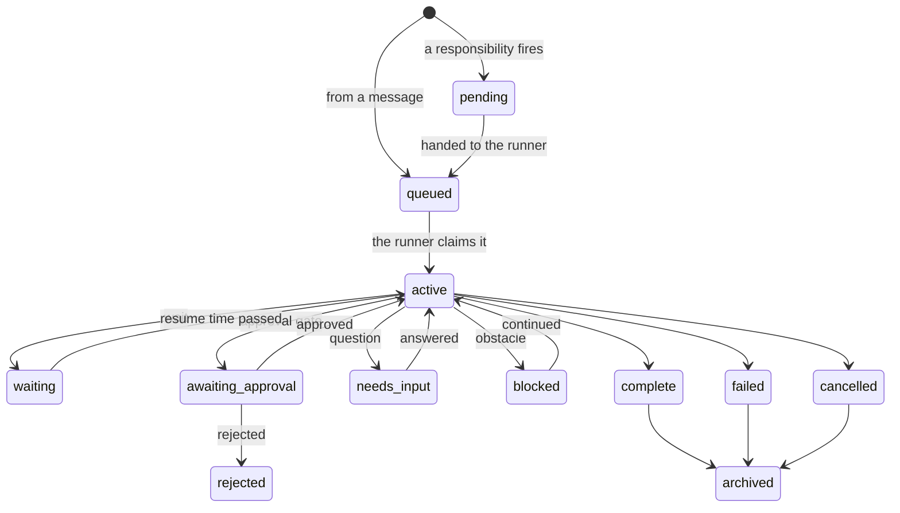

# Culture of work

How the agent turns what people ask into finished, checked work. This page covers the one shape work
takes (request, mission, checkpoint, task), how a message becomes a mission, how a mission is planned,
run, verified and finished, the states work moves through, who approves what, and the things work
draws on: projects, processes, responsibilities, artifacts and skills. Read it before you change the
brain service, the [work package](../../agent/work/README.md), an organ prompt, a skill, or a role's
processes and responsibilities. Each statement names the code that makes it true; when this page and
the code disagree, the code is right and this page is the bug. Words mean what the
[glossary](../GLOSSARY.md) says.

## The shape of work

Work has one shape: Request → Mission → Checkpoint → Task (`ENVELOPE_TYPES` in
`agent/work/work-schema.mjs`). Each level is an envelope: a document in the Firestore `work`
collection with a `type` of `R`, `M`, `C` or `T` and a `parent_id`.

| Level | What it is | Who writes it |
|---|---|---|
| Request (`R`) | A container for work nobody asked for in the moment. It is complete as soon as it is written, and it is the parent of one mission | The scheduler, when a responsibility fires (`agent/work/scheduler.mjs`) |
| Mission (`M`) | The unit of work: one goal, its acceptance criteria, its stakes, its project | The brain, from a person's message (`agent/services/brain/intake-handlers.mjs`), or the scheduler |
| Checkpoint (`C`) | One milestone of a mission. The cerebellum (the organ that verifies) judges it when its tasks end | The checkpoint executor (`agent/work/checkpoint-executor.mjs`) |
| Task (`T`) | One outcome, run by one organ in one turn | The checkpoint executor |

A person's message is not stored as an `R` envelope. It arrives as an intake document, and the brain
makes the mission from it directly. Besides a responsibility's firing, the brain writes an `R` only
as its reply to an approval message that resolved nothing: a question about which gate was meant, or a
note that the sender may not approve (`agent/services/brain/approval-replies.mjs`).

Not every checkpoint and task is planned work. The brain also writes a small checkpoint-and-task pair
for an acknowledgment and for each synthesis, and single notification tasks (an approval request, a
pause note) for the mouth to deliver (`createCT` in `agent/services/brain/envelope-store.mjs`).

**Missions never nest.** The work schema declares the rule: a mission may have a parent only when a
responsibility fired it (`WORK_SCHEMA` in `agent/work/work-schema.mjs`). The brain's tests check every
envelope it writes against that schema (`tests/agent/services/brain/main.test.mjs`), and at runtime
the brain's store turns any other parented mission into a checkpoint before saving it
(`enforceMissionParentInvariant` in `agent/work/plan-utils.mjs`, called from
`agent/services/brain/envelope-store.mjs`). A mission is the unit that is planned, verified, delivered
and remembered on its own, and completion sends only a parentless mission's outcome back to whoever
asked (`agent/services/brain/completion.mjs`): a mission nested in another would finish with nobody
told.

**Every status change is a legal move.** One table lists them (`LEGAL_TRANSITIONS` in
`agent/work/work-transitions.mjs`), and `applyTransition` applies a move and stamps the fields it
needs. With `brain.transition_guard` at `enforce` in [config/contracts.json](../../config/contracts.json),
an illegal move throws instead of being written. See [Lifecycle and states](#lifecycle-and-states).

## From a message to a mission

1. The ears write one intake per inbound message, from the dashboard or, on a Workspace role, from
   Google Chat (`agent/services/ears/intake.mjs`). Its id comes from the channel's message id, so a
   message read twice is still one intake.
2. The brain claims each pending intake, oldest first, and records the turn in the conversation's
   thread ledger (`agent/services/brain/intake.mjs`).
3. Before any model sees it, the brain checks whether the message is an approval reply ("approve",
   "reject") for a pending gate in the same conversation (`agent/services/brain/approval-replies.mjs`).
   If it is, the brain resolves the gate, and nothing else happens.
4. Otherwise the cortex (the organ that decides) classifies it, with the conversation, recalled
   memory, the missions in flight and the five most recently completed missions in view.
5. For work a person asked for, the brain sends an acknowledgment at once. Work from the agent's own
   sources (`brain`, `system`, `scheduler`) gets none.

| Classification | What the brain does (`agent/services/brain/intake-handlers.mjs`) |
|---|---|
| `new_mission` | Creates a mission in `queued`, with the cortex's instruction, acceptance criteria, stakes (`routine` unless the cortex said `consequential` or `irreversible`), project (the one the cortex named if it exists, else the default project) and the files shared with the message |
| `respond` | Answers at once: a mission written already `complete`, its answer as its output, for the mouth to deliver. The cortex may first ask for one read of the agent's own recent work (`brain.respond_reads`). A respond it cannot ground becomes a new mission |
| `attach` | A follow-up to a named mission. A status question about running work gets a short status reply. An answer to a mission in `needs_input` resumes it, and a `blocked` mission is continued. Anything else starts a follow-up mission that carries the earlier one as context |
| `continue` | Resumes a mission in `needs_input` or `blocked`, with the person's words as its next input. A running mission is handled as an attach. A finished mission is never reopened, so its continuation is a follow-up mission |
| `cancel` | Cancels the named mission and its unfinished checkpoints and tasks. If the runner holds the mission, it stops at its next decision |

A running mission is never written to from outside: new instructions for it become a follow-up
mission. An intake that fails is put back and tried again, and after three attempts it is marked
failed with the reason (`MAX_INTAKE_ATTEMPTS` in `agent/services/brain/intake.mjs`).

## Running a mission

The brain runs one mission at a time (`agent/services/brain/envelope-runner.mjs`). Its runner takes,
in order:

1. an `active` mission nobody holds: a resumed wait, an approved gate, an answered question, a
   continued blocker, or one a restart left behind. The least recently updated goes first;
2. the oldest `queued` mission whose dependencies are done.

It claims the mission durably, so no second process runs it, recalls memory for it unless the intake
already did, and prepares its mission tree (`initWorkspace` in `agent/work/artifacts.mjs`). Then it
does one of three things:

- after an approval, it continues the paused plan at the task after the gate;
- after a restart mid-plan, it continues from the progress the executor saved (`_cp_progress`);
- otherwise it runs the decide loop.

### The decide loop

On the first iteration the prefrontal (the organ that plans) analyzes the request into a brief: its
parts, each part's risk (`none`, `mutating` or `destructive_or_public`), what each depends on, what is
unknown, which playbook matches, and the one assumption that would sink the work (the `analyze`
schema in `agent/providers/vertex-text.mjs`). Then, each iteration, the cortex chooses exactly one
move, and the brain carries it out (`agent/services/brain/actions/index.mjs`):

| Move | What happens | Does the run end? |
|---|---|---|
| `checkpoint_plan` | A plan is settled and run by the checkpoint executor. Its results come back for the next decision | Only if the plan pauses at an approval gate |
| `synthesize` | The cortex proposes that the mission is done. The brain checks the proposal and completes the mission (see [Finishing](#finishing-a-mission)) | Yes, once it is accepted |
| `synthesize_with_failure` | An honest account of work that did not fully succeed | Yes, after one chance to resolve the failure another way |
| `needs_input` | The mission asks the person a question and stops in `needs_input` | Yes |
| `blocked` | The mission stops on an outside obstacle and stops in `blocked` | Yes |
| `status_update` | A short progress note for the mouth | No |
| `wait` | The mission pauses for 1 to 1,440 minutes (`brain.wait_min_minutes`, `brain.wait_max_minutes`; 5 by default) and then resumes with the cortex's next step (`agent/services/brain/waits.mjs`) | Until the time passes |
| `trigger_responsibility` | Starts a responsibility marked `triggerable` as its own mission, then steers the cortex to a short confirmation | No |

Code, not the cortex's judgment, holds the loop to these limits:

- A plain `synthesize` over a failed task that nothing has resolved since is refused, except on the
  mission's last turn (`agent/services/brain/actions/synthesize.mjs`).
- Once every checkpoint passed in this run, a new plan is refused: verified work is delivered, not
  done again (`passedThisRun` in `agent/work/checkpoint-spine.mjs`).
- A `blocked` over work whose tasks all succeeded is turned, once, into a verified synthesis
  (`agent/services/brain/actions/blocked.mjs`).
- A mission that reaches its limit of decisions (`brain.max_iterations`, 50), counted over its whole
  life, ends `failed`.
- An error is retried after a minute. The third error in a row fails the mission; a storage outage
  never counts (`MAX_MISSION_ERRORS` in `agent/services/brain/envelope-runner.mjs`).

After three failed plans the cortex is also told it must escalate (`MAX_REPLANS` in
`agent/services/brain/actions/checkpoint-plan.mjs`). That one is an instruction, not a refusal: the
limit of decisions is what stops a cortex that ignores it.

Results reach the cortex as result packets: a summary, and a `ref` it can name in `request_context` to
get the full output on its next turn (`agent/work/result-packet.mjs`,
`agent/services/brain/mission-context.mjs`). The brain also rewrites the mission's blackboard,
`MISSION.md` at the root of the mission tree, on every iteration, and compacts the mission's
accumulated context when it nears its budget.

## Planning: the checkpoint spine

Every piece of execution is a plan, even one checkpoint with one task. The `checkpoint_plan` move
settles the plan this way (`agent/services/brain/actions/checkpoint-plan.mjs`):

- The cortex's own plan is used when it gave a valid one. Otherwise the prefrontal structures one,
  following the plan-structuring skill (`skills/plan-structuring/SKILL.md`).
- Tasks run only on the motor (the organ that executes with tools), temporal-research and
  temporal-memory (`VALID_TASK_ORGANS` in `agent/work/checkpoint-executor.mjs`). The planning and
  verifying organs never run a task.
- **The first plan pins the checkpoint spine**: each checkpoint's outcome, acceptance criteria and
  tasks (`buildSpine` in `agent/work/checkpoint-spine.mjs`). After a failure, a later plan re-tasks
  only the first checkpoint that has not passed, against its pinned outcome. Passed checkpoints keep
  their verdicts, so a failure at checkpoint 2 never re-runs checkpoint 1. A checkpoint's criteria may
  be reworded once (`brain.max_criteria_revisions`); after that the pinned wording stands.
- Identifiers the person stated are seeded into the mission's resource ledger, shown to the planner as
  known resources, and a plan's mistyped ids are repaired against them before anything is pinned
  (`agent/work/resource-ledger.mjs`). A task that depends on an id an earlier task must find is logged
  as a plan smell (`agent/work/plan-lint.mjs`).
- When the brief marks a part `destructive_or_public` and the plan has no approval gate, the cortex
  gets one warning, once per mission; then the plan runs as it is.
- When the prefrontal structures the plan, playbooks whose recall phrases appear in the goal are
  offered to it as guidance (see [Processes](#processes)).
- A memory-scoped mission is planned by code, not by an organ: one checkpoint whose one task runs the
  whole cycle on temporal-memory (`memoryMissionPlan` in `agent/work/memory-scope.mjs`).

## Checkpoints and tasks

The checkpoint executor runs a plan's checkpoints in order (`agent/work/checkpoint-executor.mjs`).
Nothing proceeds past a failure.

**Each task** gets its own task envelope and one organ turn through the gateway. The organ receives the
task, its criteria, the mission's known resources, the project's context, the files shared with the
request, and the earlier checkpoints' results as digests. Then:

- A motor result whose tool log shows a failed command fails the task, unless the motor recovered and
  still produced the result. A delivery-critical task (a deploy, a publish) recovers only when the log
  shows the action itself succeeding (`applyMotorCheck` in `agent/work/task-outcome.mjs`).
- A required task that failed is retried once, told why it failed. A reply cut at the token limit is
  told to write large content to a file; a timeout is told its outcome is unknown and to check state
  first. An optional task is not retried.
- A motor success that was very fast, used almost no tools and changed nothing durable gets an evidence
  warning for the cerebellum to weigh. A warning never fails a task by itself.
- Identifiers in the output are captured into the resource ledger, and a long result is kept as a step
  note in the mission tree.
- The step ledger records the task (`agent/work/step-ledger.mjs`), and the progress is saved, in one
  write. A mission resumed after a restart replays a finished task with its recorded output instead
  of running it again.
- A failed task ends the checkpoint.

**An approval gate** is a task with `step_type: approval_gate`. It runs no organ: it writes an
approval document, pauses the checkpoint and the mission in `awaiting_approval`, and sends the person
a request that says what runs once it is approved (`describeApprovalGate` in
`agent/work/approvals.mjs`). If the approval document cannot be written, nothing is paused and the
mission is tried again later: a mission waiting on an approval nobody can see would wait forever.

**The milestone.** When a checkpoint's tasks are done, the cerebellum judges whether their combined
work meets the checkpoint's acceptance criteria (`verifyMilestone` in
`agent/work/checkpoint-verify.mjs`):

- The verdict is the verdict tool the cerebellum called, `report_pass` or `report_fail`, read from the
  tool log; prose is never read for it (`agent/work/verdict.mjs`).
- It is graded: met, met with a caveat (a gap that does not defeat the deliverable, shown to the
  person), or not met.
- A first look made on a partial view of the evidence is checked again on the complete evidence, and
  so is a failure that only says the evidence was out of sight.
- At `consequential` stakes or above (`brain.attack_duty_stakes_min`), or for work the brief marks
  load-bearing, a separate adversarial pass tries to overturn a pass. An attack that lands fails the
  milestone; one that cannot be judged leaves a caveat.
- No verdict at all fails the milestone as inconclusive, which is not a judgment that the work is
  wrong. A checkpoint is never recorded as passed without a verdict.

A checkpoint that passed is marked complete on the spine, and the mission tree is committed and
pushed to the mission's branch. A checkpoint that failed is marked failed, its step-ledger entries are
cleared so its tasks run again on the next attempt, and the plan stops. The results go back to the
cortex, which decides what comes next.

## Finishing a mission

**Synthesize.** Before a synthesis completes a mission (`agent/services/brain/actions/synthesize.mjs`):

1. An unresolved real failure refuses it, except on the mission's last turn. Inconclusive and
   timed-out rows do not count as failures.
2. With a pinned spine, the last checkpoint is the deliverable. While it is not complete, the mission
   cannot be reported complete (`finalizeBlockedBySpine` in `agent/work/checkpoint-spine.mjs`). On the
   mission's last turn it ends in `needs_input` instead.
3. The answer is composed answer first: the answer, the reasoning, then the risk and the assumptions,
   least certain first, each in its epistemic bin. An unlabelled claim falls into `assumed`.
4. The cerebellum verifies the synthesis against the acceptance criteria, with an attack duty at
   `consequential` stakes and above. Only a short answer to a mission without real criteria skips this
   (`brain.synth_verify_min_chars`). A failed check steers the cortex to `synthesize_with_failure`,
   never to redoing verified work.
5. Caveats from the checkpoints and the synthesis check are appended to the answer, never dropped
   (`renderCaveatSection` in `agent/work/finalization.mjs`).

**Synthesize with failure** (`agent/services/brain/actions/synthesize-with-failure.mjs`). If the
recent work in fact all succeeded, it becomes a plain synthesis. The first time, the cortex gets one
chance to resolve the failure another way. After that, a mission ends `complete` if that chance
produced successful work, and otherwise `blocked`, with the synthesis as its account.

**Blocked** (`agent/services/brain/actions/blocked.mjs`). The handback always says what is in the way.
When the cortex named nothing, the blocker is recovered from the failing task's own report
(`articulateBlocker` in `agent/work/finalization.mjs`). A blocked mission waits for a person to
continue it.

**Completion** is the one way a run ends (`agent/services/brain/completion.mjs`), whatever the
status:

1. The deliverable is never empty: a real synthesis is used as written, and an empty one is replaced by
   a summary composed from the mission's own state (`agent/work/deliverable.mjs`).
2. The status moves through the transition table.
3. A mission with no parent is set for delivery to the address it came from; the mouth voices and
   sends it (`agent/services/mouth/delivery.mjs`). A responsibility's mission has a parent, so its
   outcome is not sent to a conversation; it is read in the dashboard.
4. A completed mission in a project gets its record written into the mission tree
   (`agent/work/mission-record.mjs`). Unless the run ended on a question or an error, the mission's
   branch is published (see [Artifacts](#artifacts)). The files it handed back ride on the reply as
   attachments.
5. Then, best effort, none of which can undo the ending: the mission's line in working memory, the
   lessons it taught about its project and its playbooks, the learnings a responsibility's mission
   feeds to the next firing, pending missions waiting on it, the project's own completion, event
   responsibilities, and suggestions for the project's context.

A `needs_input` mission keeps its mission tree, and its memory line waits for the real end.

## Lifecycle and states

Statuses and legal moves are in `agent/work/work-transitions.mjs`. A mission moves like this:

| Status | Meaning | Entered by | Leaves to |
|---|---|---|---|
| `pending` | Written, not yet handed to the runner | A responsibility's mission (`agent/work/scheduler.mjs`) | `queued` (`agent/services/brain/responsibilities.mjs`); `active` once its dependencies finish (`activateDependents` in `agent/work/projects.mjs`); `cancelled` |
| `queued` | Waiting its turn | A new mission from a message; a responsibility's mission | `active`, `cancelled` |
| `active` | Running, or ready to continue | The runner; every resume | Any pause or ending |
| `waiting` | A timed pause | The `wait` move | `active` once `wait_resume_at` passes (`agent/services/brain/waits.mjs`); `cancelled` |
| `awaiting_approval` | Paused at an approval gate | The checkpoint executor | `active` (approved), `rejected` (rejected), `cancelled`. An approved mission that cannot resume goes through `active` to `failed` (`agent/work/approvals.mjs`) |
| `needs_input` | Waiting for a person's answer | The `needs_input` move, or a completion refused on the last turn | `active` once answered; archived if nobody answers |
| `blocked` | Stopped on an obstacle, and can be continued | The `blocked` move; `synthesize_with_failure` once its one chance is spent | `active` once a person continues it; `cancelled` |
| `complete` | Finished | Completion | `archived` |
| `failed` | Ended without its result | Completion; the executor, for checkpoints and tasks | `archived` |
| `rejected` | A person rejected its gate | The approvals poller | `archived` is legal, but the sweep does not archive it |
| `cancelled` | Stopped by a person, or by the sweep | A cancel; the archival sweep | `archived` |
| `archived` | Out of the working set | The archival sweep | Nothing |

The table also declares `planned`, `needs_review` and `timed_out`, and no code moves an envelope into
them. `needs_review` is used instead as a flag on a checkpoint or mission that a person should look at
(a verification that could not judge).

Checkpoints and tasks are written `active` and end `complete` or `failed`. A checkpoint can also pause
in `awaiting_approval`. Both are cancelled with their mission. Notifications and acknowledgments are
written already `complete`.

The reducer adds what each move needs. The first activation stamps `started_at`; every ending stamps
`completed_at`; `failed` carries an `error` and `blocked` a `blocker`; and `waiting` needs
`wait_resume_at`, because a wait with no end time has nothing to end it. Resuming clears the old
blocker and wait fields. A finished envelope is never reopened: its recorded outcome would then
describe work it did not produce.

**The archival sweep** runs hourly (`archival.interval_ms`) and keeps the `work` collection current
(`agent/work/archival.mjs`). With the values in the contracts:

| Envelopes | What happens |
|---|---|
| `failed`, older than 24 hours | Archived |
| `complete`, with a parent (checkpoints, tasks, a responsibility's mission) | Archived at once, once nothing waits for delivery |
| `complete`, without a parent, more than 24 hours after it finished | Archived once nothing waits for delivery and its memory line is written; after 7 days, archived regardless |
| `needs_input`, unanswered for 72 hours | Archived |
| `cancelled`, older than 24 hours; `timed_out` | Archived |
| `waiting` with no resume time, idle 48 hours | Cancelled. A timed wait is never cancelled before its resume time: the brain resumes it |
| `active`, idle 12 hours | Cancelled |
| Children of a cancelled, archived, failed or missing parent | Cancelled |

Apart from orphaned children, the sweep leaves `pending`, `queued`, `blocked`, `awaiting_approval` and
`rejected` work alone. It writes its statuses directly rather than through `applyTransition`, so it
archives an unanswered `needs_input` mission straight to `archived`, a move the table does not list.

**After a restart** the runner releases the claims a previous process left, so their missions
continue, and queues responsibility missions left `pending` (`recover` in
`agent/services/brain/envelope-runner.mjs`). The intake puts back intakes a previous process claimed
but never finished (`recover` in `agent/services/brain/intake.mjs`).

## Who approves what

| What | Who decides | How, and where the code is |
|---|---|---|
| An approval gate | Any dashboard user, admin or member | On the dashboard's Approvals page (`dashboard/lib/server/approvals.mjs`), or by replying "approve" or "reject" in chat (`agent/services/brain/approval-replies.mjs`). A dashboard reply resolves only the pending gates raised in its own thread, even when one gate is all that is pending anywhere, and asks which when there are several (`dashboardScopedApprovals` in `agent/services/brain/approval-replies.mjs`); a reply that finds the gate already decided is told so, and changes nothing. In Google Chat, a reply counts only when its sender is matched to a dashboard user who still holds a dashboard role, and only for gates whose mission came from that space. Each gate records who asked and who decided |
| Whether a plan has a gate | The plan | The cortex and prefrontal prompts require a gate before a destructive or public action (`prompts/cortex.md`, `prompts/prefrontal.md`). Code adds one warning when the brief marks such a part and no gate is planned, and then lets the plan run; the motor's prompt tells it to refuse an irreversible step no gate preceded (`prompts/motor.md`). A memory-scoped mission may not open a gate at all (`fenceMemoryTask` in `agent/work/memory-scope.mjs`) |
| Turning a responsibility on or off, "run now" | Dashboard admins | Signed commands to the control service (`ADMIN_COMMANDS` in `dashboard/lib/server/commands.mjs`, `agent/services/control/responsibilities.mjs`) |
| Running a responsibility out of turn from chat | Anyone who reaches the agent | Only one marked `triggerable` (`agent/services/brain/actions/trigger-responsibility.mjs`) |
| The agent's own responsibilities, processes and projects | The agent | Through its commands, with no approval. A `locked` responsibility changes only with a release (`planWrite` in `agent/work/responsibility-store.mjs`). The dashboard shows playbooks and projects read-only (`dashboard/lib/server/library.mjs`) |
| Cancelling a mission | Anyone who reaches the agent | By asking it in the conversation (the `cancel` classification). In Chat that includes people who are not dashboard users ([open items](../plan/OPEN_ITEMS.md)) |

A gate's decision acts on the mission at once after a chat reply, and otherwise at the approvals
poller's next turn, every fifth intake pass (`APPROVALS_EVERY` in `agent/services/brain/main.mjs`),
about every 15 seconds at the contracts' 3-second poll. An approved mission resumes at the task after
the gate, and the gate's row says who approved it, so neither the next task nor the verifier asks
again. A rejected mission ends `rejected` and is delivered with the reason. Every dashboard user sees
every mission and every approval, whoever asked (`dashboard/lib/server/work.mjs`,
`dashboard/lib/server/approvals.mjs`).

Three things look like approvals but have no approval path today:

- **Project context suggestions.** With `projects.promotion_auto` off, as the contracts ship it, a
  finished mission's new project context is written as suggestions under its project
  (`suggestContextPromotions` in `agent/work/projects.mjs`). The dashboard's Library lists them; nothing
  accepts one.
- **Gated merges.** A project whose merge policy is `gated` (set on the project, or any project of
  class `code`) has its mission's merge parked in the mission's `context.pending_merge`
  (`resolveMergePolicy` and `publish` in `agent/work/artifacts.mjs`). Nothing resolves a parked merge.
- **Canon.** A project's canon is changed only by `project-manage` commands the agent runs, and their
  authority check compares the list with the agent's own address (`agent/cli/project-manage.mjs`).
  No skill documents those commands ([open items](../plan/OPEN_ITEMS.md)).

## The primitives around a mission

### Projects

A project is a body of work with its own context and its own artifact repository, a document in the
`projects` collection (`PROJECT_SCHEMA` in `agent/work/work-schema.mjs`, the registry in
`agent/work/projects.mjs`).

- Every mission has a project. The brain creates the default project, `general`, when it starts, and a
  mission that names no project gets it.
- The cortex sees every project's name, description and context when it classifies and decides. A
  mission's tasks see their project rendered into the prompt: its name and description, its canon
  (marked authoritative), its deploy target, its context entries and its shared Drive folder
  (`buildContext`).
- What a project's context may hold is decided by one validator (`agent/work/project-context.mjs`):
  durable resource references and working conventions, never a mission's particulars. See the
  [module charter](MODULE_CHARTER.md#projects).
- Projects nest up to four levels deep. A project marked `auto_complete` completes itself once its
  sub-projects, its missions and the projects it depends on are done.
- The agent creates and changes projects with `project-manage` (`agent/cli/project-manage.mjs`). The
  dashboard shows them read-only.

A mission can also wait on other work through its own `depends_on` list: the runner holds a queued
mission back until that work is complete, and completion wakes the missions waiting on it. No code
path gives a mission a `depends_on` today.

### Processes

A process is a playbook: a name, a one-line description, and a narrative of how a recurring kind of
work has gone well, with optional recall phrases (`intent_keywords`). It is never executed as steps
(`agent/work/process-registry.mjs`). It reaches work in four ways:

1. The cortex sees every playbook's name, description and narrative on every decision
   (`processRegistry` in `agent/services/brain/prompt-assembly.mjs`).
2. When the prefrontal structures a plan, playbooks whose recall phrases appear in the goal are offered
   to it as guidance to fold into its own checkpoints, and they are recorded on the mission
   (`agent/services/brain/actions/checkpoint-plan.mjs`).
3. A responsibility's `processRef` puts that playbook's narrative into its mission's context when it
   fires (`agent/work/scheduler.mjs`).
4. After the mission, temporal-memory may write one lesson per playbook the mission drew on into
   working memory; the playbook itself is not changed (`recordLessons` in
   `agent/services/brain/memory.mjs`).

The library is the installed playbooks of the generic role and the instance's role (generic first;
the first id wins, `agent/work/role-packages.mjs`) with the agent's own playbooks from the `processes`
collection over them: a stored playbook replaces an installed one with the same id. The agent writes
and retires its own with `process-ops` (`agent/cli/process-ops.mjs`); retiring marks one deprecated and
deletes nothing. How to write a good one: [guides/PROCESSES.md](../guides/PROCESSES.md).

### Responsibilities

A responsibility is work the agent owns on a schedule (a five-field cron read in its own timezone) or
on an event. The record's shape is `agent/work/responsibility-schema.mjs`; how to write one, and what
the scheduler guarantees about time, is in [guides/RESPONSIBILITIES.md](../guides/RESPONSIBILITIES.md).
In the work model:

- **A firing is a request and a mission.** The scheduler writes an `R` envelope, complete at once, and
  its mission in `pending`, then hands the mission to the runner's queue; the runner, not the
  scheduler, runs it, so scheduled work never runs beside another mission
  (`agent/services/brain/responsibilities.mjs`). The mission carries the purpose, the process steps,
  the linked playbook, the reference files, the success criteria and the prior learnings as its
  context.
- **Two layers, one merge.** The installed defaults come from the generic role and the instance's
  role; the agent's own records in the `responsibilities` collection override a default or add new
  ones. The scheduler, the control service and the agent's `responsibility-manage` command all merge
  through `agent/work/responsibility-store.mjs`, so what the dashboard shows is what fires. A store
  record that is invalid, or that tries to change a `locked` default, is reported and skipped, and the
  default keeps running.
- **Guards.** A `singleton` responsibility does not fire while an earlier firing's mission is still
  `pending`, `queued`, `active` or `waiting`; `min_spacing_minutes` sets a floor between firings.
  Event responsibilities fire on `on_complete` and `on_failure`, which completion raises
  (`completionEvent` in `agent/services/brain/completion.mjs`), and never from an event-fired
  mission, so they cannot chain.
- **Learnings.** A completed responsibility mission's durable learnings feed the next firing's prior
  learnings, through the `responsibility_state` collection, never the installed file
  (`feedResponsibilityLearnings` in `agent/services/brain/completion.mjs`).
- **Memory scope.** A responsibility with `effect_scope: "memory"` (the nightly consolidation in
  `roles/generic/responsibilities.json`) fires a mission that may change only the memory layers: its
  tasks run on the memory organs, and it may not open an approval gate (`agent/work/memory-scope.mjs`).

### Artifacts

An artifact is a file the agent produced, kept in its project's repository in the git artifact store:
git bundles in the instance's bucket, with one ref document per branch (`agent/storage/git-store.mjs`).

- Each mission works in its own mission tree under the data root, a checkout of its project's
  repository on the branch `mission/<id>` (`initWorkspace` in `agent/work/artifacts.mjs`). The tree's
  local git excludes keep scratch out of every commit: fetched inputs, images and archives by default,
  the brain's bookkeeping, and the agent's memory files.
- Each checkpoint that passes commits and pushes the branch.
- When the mission completes, `publish` merges the branch into the project's default branch under the
  project's merge policy and records an artifact manifest of the changed files on the mission and the
  project. For a mission that came from the dashboard, up to 20 changed files are also exported as
  downloads.
- What a person receives is separate from what is committed: a file reaches the dashboard only as an
  outgoing file, handed back with `file-share` (the files skill, `skills/files/SKILL.md`) or exported
  at publish, and recorded in the `files` collection (`agent/files/outgoing.mjs`).

### Skills

A skill is codified procedure: the instructions and the commands for one kind of work. The package
format is in the [skills README](../../skills/README.md); how to write one is in
[guides/SKILLS.md](../guides/SKILLS.md). In the work model, a skill is how an organ learns the method.
The planning organs see only a one-line capability map, which organ can do what, and plan by outcome
(`capabilityMap` in `agent/services/brain/prompt-assembly.mjs`). The organ that does the task sees
where every SKILL.md is (`agent/gateway/skill-catalog.mjs`) and reads the one that governs its work
before its first command.

## Where to read next

| Doc | For |
|---|---|
| [Module charter](MODULE_CHARTER.md) | What belongs in an organ prompt, a skill, a process, a project, a role package or the memory |
| [Product rules](../canon/PRODUCT.md) | The rules every change keeps |
| [The brain's qualities](../canon/BRAIN.md) | Why the brain is built this way |
| [Open items](../plan/OPEN_ITEMS.md) | What is known to be missing |
