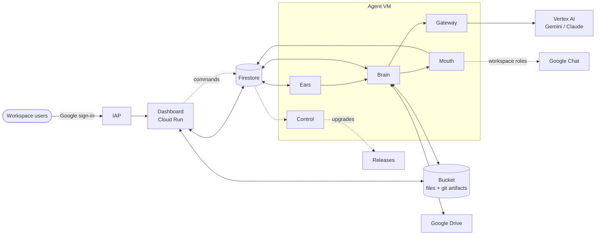

# Paraclete Build Plan

**Status:** in progress · **Started:** 2026-10-17

This is what paraclete is, the decisions behind it, and the order of the work. It is the overall
mission for anyone developing this repo. When a decision changes, change this plan in the same commit.

---

## 1. What paraclete is

| | Rule |
|---|---|
| P1 | One Google Cloud project holds exactly one paraclete. |
| P2 | The repo is public. A project owner installs it with one command from Cloud Shell. |
| P3 | Every paraclete has its own dashboard behind Google sign-in. The person who installed it is the first user, and dashboard admins add more. |
| P4 | Each paraclete has one role, chosen at install. `generic` is the default and the base every other role builds on. |
| P5 | A Google Workspace account for the agent is optional. Only roles flagged `workspace` get one. |
| P6 | Every paraclete works with files and Google Drive. It takes files in, works on them, and hands back standard file types as dashboard downloads. |
| P7 | It runs on Gemini by default. Claude is an upgrade the owner turns on after accepting Anthropic's terms. |
| P8 | Upgrades come from this repo's releases. One button moves the dashboard and the agent to the same release. |

The agent is a deterministic machine that consults models: code moves the data and enforces the
rules, and models think in structured JSON. Work runs Request → Mission → Checkpoint → Task. An
independent verifier judges every checkpoint, and every outbound message leaves through one service.

---

## 2. Decisions

| Area | Decision |
|---|---|
| Topology | One VM for the agent, one dashboard on Cloud Run, Firestore, one Cloud Storage bucket. The VM runs host-native systemd services, no containers. |
| Roles | One per instance, chosen at install. `generic` is the default and the base of every role. |
| Workspace | A flag on roles. A flagged role gets a Google account through domain-wide delegation (DWD), Google Chat as a channel, and the Workspace skills. |
| Drive | Every agent, `generic` included. It acts as its service account by default, and as its own Google account on Workspace roles. |
| Files | Every agent takes files in from the dashboard, links, Cloud Storage, git and Drive, and returns standard files as dashboard downloads. |
| Dashboard sign-in | Identity-Aware Proxy (IAP) directly on Cloud Run with Google's managed sign-in. No OAuth client to create. |
| Models | `gemini-4-argon` for the cortex and the strong tier, `gemini-3.8-flash` everywhere else. Claude is opt-in. |
| Upgrades | The dashboard detects releases of this repo. An admin installs one with a button. |
| Runtime | Node 24 on the VM and the dashboard. |
| Email | Not in this plan. |

---

## 3. Architecture



### Services on the VM

| Service | Job |
|---|---|
| Gateway | Runs organ turns against Vertex AI: the tool loop, caching, sessions and fallbacks |
| Brain | The mission loop: intake, planning, checkpoints, verification, finalization and the scheduler |
| Ears | Inbound messages and file drops. Serves several channels at once: the dashboard always, Google Chat on Workspace roles |
| Mouth | The only way out: replies, deliveries and attachments |
| Control | The dashboard's bridge to the VM: status, skills, config, responsibilities, model switch, upgrades and restarts |

### Identities

| Identity | Used by | Gets |
|---|---|---|
| `paraclete-dashboard@` | Cloud Run | Firestore, the bucket, Secret Manager, Cloud Build and Cloud Run (self-upgrade), IAP policy on its own service (user management), signing its own upload URLs |
| `paraclete-agent@` | The VM | Vertex AI, Firestore, the bucket, logging and metrics, secrets the dashboard grants it, Drive through the VM's scopes, plus whatever the role declares |
| `paraclete-dwd@` | Workspace roles only | Nothing in GCP. Its client ID receives the DWD grant in the Admin console |
| The agent's Google account | Workspace roles only | Chat, Drive, Docs, Sheets, Slides, Calendar and Gmail read, through `paraclete-dwd@` |

The VM never runs as the default compute service account, and nothing relies on that account's
automatic Editor grant.

### Data

Firestore collections sit at the root, because one project holds one agent: `agent` (one document),
`users`, `threads`, `messages`, `intake`, `work`, `approvals`, `processes`, `projects`,
`responsibilities`, `core_memory`, `tool_results`, `files`, `commands` and `config`.

Configuration is one `config/contracts.json`, with no compile step. One `install/manifest.txt` lists
every file installed onto the VM.

---

## 4. Roles

A role is a focus plus a few heavier tools on top of the generic agent. Each paraclete has exactly
one, chosen at install. The package format is in [roles/README.md](../../roles/README.md); the
generic role is described in [roles/generic/README.md](../../roles/generic/README.md).

### Catalog

A role with a Workspace account gets the Workspace skills (Calendar, Gmail read, Docs, Sheets, Slides),
Google Chat as a channel, and Drive as its own account; the dashboard's setup wizard connects the
account after install.

| Role | Workspace | Adds to generic |
|---|---|---|
| Generic | no | Nothing; this is the base |
| Executive Assistant | yes | Calendar management (own calendar; invitations only when asked, behind an approval); a daily briefing, off until a person asks for it |
| Project Manager | yes | Meeting notes and status reports in Docs and Sheets |
| Finance Analyst | yes | Billing analysis over the Cloud Billing export in BigQuery (a capped, read-only query command); BigQuery Job User, and Data Viewer on the export granted by a billing admin |
| Legal Advisor | yes | Contract review and obligation tracking; redlines as Docs comments or a new copy, never edits to the reviewed document |
| Designer | yes | Design-system procedures, presentation design, accessibility checks (a contrast checker) |
| DevOps Engineer | no | gcloud, Cloud Build images (no Docker on the VM), Cloud Storage, Firebase Hosting; Cloud Run and Cloud Build roles, and Artifact Registry and act-as only on its own repository and account |
| Software Engineer | no | Coding, code review, pull requests through the `gh` CLI with a token from Secrets |
| QA Engineer | no | Test runs, regression runs and defect reports |
| Data Engineer | no | BigQuery loads, queries and schema changes; BigQuery User and Data Editor |
| Security Engineer | no | Read-only IAM and exposure audits; Security Reviewer, Cloud Asset Viewer, Org Policy Viewer |
| Web Master | no | Site audit (Lighthouse), custom domains, Firebase Hosting, read-only gcloud |

Role prompts hold domain rules only: devops "a deploy passes only on a live 2xx", legal "assist and
escalate, never give legal advice", engineering "done means tested". The base prompt plus one role
file is the whole composition.

---

## 5. Files and Drive

Every paraclete gets a `files` skill and a `drive` skill. Together they take a file from wherever it
was shared, let the agent work on it locally, and hand back a standard file.

| | |
|---|---|
| **In** | Files dropped into dashboard chat; any http(s) link; objects in the project's Cloud Storage; git repos (public, or private with a token in Secrets); Drive files and folders shared with the agent |
| **Work** | Read anything to text or Markdown (PDF, Word, Excel, PowerPoint, CSV, HTML); images go to the model as pixels; edit, convert, merge, split |
| **Out** | Markdown, PDF, Word (.docx), Excel (.xlsx), CSV, PowerPoint (.pptx), HTML, PNG, SVG, JSON, ZIP. Shown as downloads on the mission in the dashboard, and optionally saved to Drive |

### Commands

| Command | Does |
|---|---|
| `file-get <source>` | Fetches from an upload id, URL, `gs://` path, git URL or Drive link into the mission's inbox, recording name, type, size, checksum and source |
| `file-read <path>` | Extracts text or Markdown, with page, sheet and slide selection |
| `file-convert <path> <format>` | Converts between the supported types |
| `file-make <format> --from <md\|html\|csv\|json>` | Builds an output file from source the agent wrote |
| `file-share <path> [--drive <folder>]` | Places the file in the mission outbox for download, and optionally uploads it to Drive |
| `drive-find`, `drive-get`, `drive-export`, `drive-put` | Search; download a file, or export a Google Doc, Sheet or Slides to an Office format, PDF or Markdown, into the mission's inbox; save a finished output as a new file |

The VM bootstrap installs the toolchain, as the generic role's apt packages without recommended ones:
pandoc, poppler-utils and qpdf for PDF, LibreOffice's headless Writer, Calc, Impress and Math, headless
Chromium, ImageMagick, `file`, two font families, and the Python libraries for Word, Excel and PDF
(python3-docx, python3-openpyxl, python3-pypdf; Debian has no python3-pptx, so a .pptx is read from its
XML and written with pandoc). Dashboard uploads go from the browser straight
to the bucket through a signed URL, so Cloud Run's 32 MB request limit doesn't apply. Inbox files
expire through a bucket lifecycle rule.

### Two Drive identities

| | Every agent (service account) | Workspace roles (agent's own account) |
|---|---|---|
| How people share | With `paraclete-agent@<project>.iam.gserviceaccount.com`, shown with a copy button in the dashboard | With the agent's Workspace address |
| Read and export | Yes | Yes |
| Create new files | Only inside a shared drive the service account belongs to. Service accounts have no Drive storage of their own. | Yes, in its own My Drive |

**Drive is a source and a destination, not a workspace.** An agent downloads what it needs into its
mission's inbox on the VM, works on it there, and hands results back as new files: dashboard
downloads, and optionally a new file in the output folder. It never edits, moves, renames, trashes or
deletes a file someone shared with it. Editing documents in place may come later, for Workspace roles.

The `drive` skill picks the identity itself: the agent's account when one is configured, the service
account otherwise. Settings has an optional output shared drive and a Test Drive button. Some
organizations block sharing with addresses outside their domain, which can include service accounts.
The install and the Test Drive button detect this and explain the options: a shared drive the service
account belongs to, an admin policy change, or a Workspace role.

---

## 6. Models

| Where | Default | With Claude turned on |
|---|---|---|
| Cortex (decides each step) | `gemini-4-argon` | Claude Opus |
| Strong tier: prefrontal (plans), motor (executes), cerebellum (verifies) | `gemini-4-argon` | Claude Opus |
| Temporal organs (memory, research) | `gemini-3.8-flash` | `gemini-3.8-flash` |
| Service calls (ears, mouth, digests) | `gemini-3.8-flash` | `gemini-3.8-flash` |
| Fallback | `gemini-3.8-flash` | `gemini-4-argon` |

`gemini-4-argon` answers only on Vertex AI's global endpoint. It returns tool calls with thought
signatures and a call `id`; the gateway must send both back.

The strong tier is on for every role. The effort setting stays as the dial.

**Turning on Claude.** Settings → Models links to Model Garden to accept Anthropic's terms. A Test
button probes the newest Claude Opus the project can reach; a switch then moves the cortex and the
strong tier to it. Gemini stays the fallback.

---

## 7. Access and users

- **Sign-in.** IAP sits directly on the Cloud Run service. Its Google-managed sign-in admits only
  accounts in the project's organization, which is the Workspace boundary. Nobody creates an OAuth
  client.
- **Prerequisite.** The project must belong to the Workspace's Cloud organization.
- **First user.** The installer grants itself `roles/iap.httpsResourceAccessor` on the service and
  becomes the first dashboard admin.
- **Two dashboard roles.** Admins manage users, settings, secrets, models and upgrades. Members chat,
  follow and approve missions, and download files. The IAP binding decides who reaches the dashboard;
  the `users` record decides what they can do.
- **Adding and removing users.** An admin enters an email; the dashboard adds or removes the IAP
  binding and the user record together.
- **Trust.** The dashboard verifies the signed IAP header (`x-goog-iap-jwt-assertion`) on every
  request, never just the email header.
- **Conversations.** Each user has their own thread with the agent. Messages carry the sender, missions
  record who asked, and approvals show who asked and who approved.

---

## 8. Install

An "Open in Cloud Shell" button on the README runs `install/install.sh` at a release tag. It asks two
questions, the role (default `generic`) and the agent's name, then runs unattended. Re-running it
repairs an install.

```
install/install.sh
  1  check      caller can act as owner, billing is on, project is in an organization, the ref resolves
  2  apis       compute, run, firestore, iam, iamcredentials, aiplatform, artifactregistry,
                cloudbuild, secretmanager, storage, iap, drive, cloudresourcemanager
                (+ Workspace APIs for flagged roles);
                then checks the cortex model answers
  3  accounts   paraclete-dashboard@, paraclete-agent@ (+ the role's gcp_roles), paraclete-dwd@ if flagged
  4  firestore  native database (delete-protected), indexes and the TTL policy
  5  bucket     <project>-paraclete: uniform access, public access prevention, lifecycle rules
  6  dashboard  Cloud Build at the tag → Artifact Registry → Cloud Run with IAP; grant the installer
  7  network    the default network (or a paraclete one); SSH from IAP only, everything else denied
  8  agent VM   e2-standard-2, 50 GB, Debian 12, paraclete-agent@, cloud-platform + drive scopes;
                the startup script runs install/bootstrap.sh at the release's commit on every boot
  9  wait       until the agent reports ready, then print where to find it
```

For development, `--ref <branch>` installs a branch and `--repo <owner>/paraclete` installs from a
fork.

**What stays manual.** Nothing, for a role without Workspace. Turning on Claude needs the owner to
accept Anthropic's terms in Model Garden. A Workspace role needs the dashboard's setup wizard: create
the agent's user, paste one client ID and the scope list into the Admin console (copy buttons and a
direct link), save the project's Chat app record in the Cloud console (a name and a description,
interactive features off; a direct link), then click Test, save, and add the agent to a Chat space
and @mention it (Chat lists a new user's conversations only once someone has written to it).
Google has no API for the DWD grant or for the Chat app record.

**Uninstall.** `install/uninstall.sh` removes everything the installer created. It keeps the bucket
unless you pass `--purge`.

---

## 9. Upgrades

1. **Releases.** Maintainers tag a release with the commit version format (`vYYYY.MM.DD.N.N`) once CI
   is green, with release notes.
2. **Detection.** The dashboard checks this repo's releases (cached hourly) and shows "Update
   available" with the notes.
3. **Install.** An admin clicks Install. Cloud Build builds the dashboard at the tag and deploys a new
   revision. The control service downloads that tag's upgrader, never the copy already installed,
   then installs, runs the validation gate and restarts the services.
4. **Migrations.** A release can carry an idempotent data migration, which the upgrader runs before
   restarting.
5. **One version.** The dashboard and the agent report the same version. Rolling back means
   installing the previous tag.

---

## 10. How the code gets here

Code is ported from a predecessor project, one package at a time. A port is a deliberate rewrite into
this layout, not a copy:

- the package arrives with its tests, under the mirrored path in `tests/`;
- it uses this repo's names and vocabulary, and its header comments explain it to a reader with no
  context;
- nothing comes across that serves coordinating several agents or one organization's setup;
- every port passes the hygiene tests, including each developer's private denylist.

---

## 11. Build sequence

Each phase ends with `npm test` green in CI. Phases 6, 7 and 8 can run in parallel once phase 5 is
done.

1. **Foundation** (done). Layout, a README in every directory, developer guide, glossary, this plan, hygiene
   and structure tests, CI.
   *Exit:* CI green; the hygiene test passes with a private denylist in place.
2. **Core libraries** (done). `agent/auth`, `storage`, `providers`, `context` and `work`, with their tests.
   Fix the timed-wait defect in section 12 on the way in.
   *Exit:* the libraries' tests pass and the dependency-direction test enforces
   [agent/README.md](../../agent/README.md).
3. **Gateway** (done). `agent/gateway` with Gemini 4 call ids, a fallback that never reruns tools that
   already ran, and a shell tool that keeps a failed command's output.
   *Exit:* gateway tests pass, including a recorded Gemini 4 tool turn.
4. **Services and configuration** (done). Brain, ears, mouth and control; `config/contracts.json`; organ
   prompts in `prompts/`; the base skills; the `generic` role package.
   *Exit:* ears, brain and mouth run a mission end to end against the in-memory Firestore fake in
   `tests/fakes/` with a scripted gateway (`tests/integration/`).
5. **Install and dev loop** (done; checked live on 2026-10-17). `install.sh` (with `--ref` and `--repo`), `bootstrap.sh`, the manifest,
   `uninstall.sh`, and the `dev/` scripts.
   *Exit:* a dev instance installed from a branch runs a full mission on `gemini-4-argon` with no
   fallbacks, and the cortex runs on Gemini without errors.
6. **Dashboard** (done and checked live, but for adding and removing a real colleague). IAP trust, users and the two dashboard roles, the single-agent shell, per-user chat,
   approvals, work views, memory, settings, and the setup checklist.
   *Exit:* add and remove a user; chat with the agent; approve a gated mission.
7. **Files and Drive** (done and checked live, but for a restricted organization's sharing policy). The `files` skill and toolchain, signed-URL uploads, mission downloads, and the
   `drive` skill with both identities.
   *Exit:* drop a PDF into chat and get a .docx back; read a Doc shared with the service account; write
   into a shared drive; the sharing-policy check reports correctly in a restricted organization.
8. **Roles** (code done; the live check is next). The 11 roles in the catalog, the Workspace flag with its setup wizard, and the Google
   Chat channel.
   *Exit:* `generic`, one Workspace role and one other role each install and pass a smoke mission.
9. **Models and upgrades.** The Claude switch, the release workflow, release detection, the upgrade
   button, and migrations.
   *Exit:* turn Claude on and off; upgrade a dev instance from one release to the next from the
   dashboard.
10. **Product docs.** `docs/canon/`, `docs/concepts/`, the guides, `docs/INSTALL.md`, and the README's
    install button.
    *Exit:* every doc matches the code, and the doc-path tests pass.

**Acceptance.** In a clean project inside a Workspace organization: one command, a dashboard link in
about 15 minutes, the owner signs in, adds a colleague, drops a spreadsheet into chat, and gets a
formatted report back as a download. Then the same flow for a Workspace role, through the setup
wizard.

---

## 12. Known defects to fix while porting

| Defect | Effect | Status |
|---|---|---|
| The stale-work sweep cancels waits after 8 hours | Timed waits may legitimately run 24 hours | Fixed in phase 2 (`agent/work/archival.mjs`) |
| A model fallback reruns the whole turn | Tools that already ran in the failed turn run again | Fixed in phase 3: the fallback continues the transcript; checked live from Gemini 4 to Flash and to Claude |
| The shell tool drops a failed command's output | The reason a command refused is lost | Fixed in phase 3 (`agent/gateway/tools.mjs`) |
| A checkpoint can pass on compacted evidence, or with an inconclusive adversarial check | The verifier passes claims it could not fully check | Phase 4, with the checkpoint executor |
| A project listing can show a placeholder dash instead of a project id | The agent has to guess which project is meant | Registry fixed in phase 2; the listing command in phase 4 |

Phase 2 also fixed defects found while porting, each with a test: shell and option injection in the
git store, a project manifest that was never saved, a scheduler guard that stopped working after a
responsibility's history grew, approvals that stopped resuming after the hundredth, recall that went
blind after 300 envelopes, a mission stranded when its resume after approval failed, and a stored
`id` field that could override a document's real id.

---

## 13. Risks and checks

- **Organization required.** IAP's managed sign-in works only for projects inside an organization. The
  installer checks this first.
- **Drive sharing policy.** Restricted external sharing may block sharing with the service account.
  Phase 7 tests this in a locked-down organization.
- **Cortex on Gemini.** The cortex's session replay and caching were first built around Claude. Phase 5
  proves them on Gemini before anything else is built on top.
- **Gemini 4 is new.** It was released on 2026-10-13 and is served only from the global endpoint. The
  installer checks the project can call it.
- **VM size.** LibreOffice and Chromium need more memory than e2-medium has. Start at e2-standard-2
  (8 GB) with 50 GB of disk.
- **Release-check rate limit.** GitHub allows 60 unauthenticated requests per hour per IP address. The
  dashboard caches the result.
- **Organization policies.** No `allUsers` invoker (IAP removes the need) and no reliance on default
  service-account grants. The installer names any policy that blocks it.

---

## 14. Not in this plan

- Email in or out
- Changing an instance's role after install, or more than one role
- Claude as the default model
- Projects outside an organization
- Moving agents in from other systems
